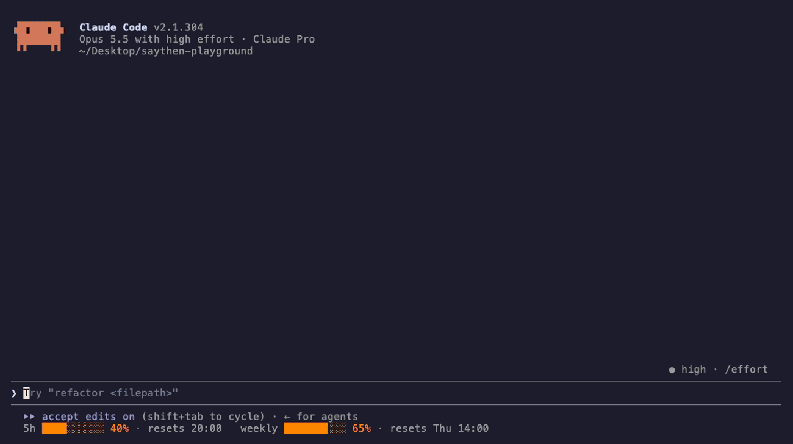

# SayThen

**Say what you mean. Let AI understand.**



SayThen is a Claude Code skill. You type `/saythen` and a request in any
language, slang and typos included. SayThen rewrites it as a clear English
instruction sized to the task and shows it to you in one dialog, in your
language and in English. You pick which version Claude receives, and nothing
runs until you approve it.

```text
/saythen bina plani ciz
```

```text
☐ Oxu  ☐ Read  ☐ Cavab dili  ☐ SayThen

Oxu: ↑/↓ ilə səhifələri çevirin
❯ 1. Səhifə 1/2   ┌ Təcrübəli memar kimi çıxış et. Bina üçün
  2. Səhifə 2/2   │ mərtəbə planı hazırla.
                  │ - Hər otağı adlandır və ölçülərini göstər.
                  └ ...

Read: the same pages in English (the text Claude receives by default)

Cavab dili
❯ Azərbaycanca (tövsiyə)
  İngiliscə
  Ləğv et

SayThen: Bu təlimat icra olunsun?
❯ Təsdiqlə: ingiliscə (tövsiyə)   Claude ingiliscə versiyanı alır
  Təsdiqlə: azərbaycanca          Claude azərbaycanca versiyanı alır
  Dəyiş
  Ləğv et
```

A short proposal has no Read tabs. Each Approve option previews its whole
version instead.

## Supported languages

You can write in any language Claude understands and mix several in one
message. The dialog and the translation use the language you wrote in. Claude
receives the English instruction unless you choose your own language.

The test scenarios cover Azerbaijani, Turkish, Russian, English, and
mixed-language requests. Other languages should work the same way, but nobody
has measured them yet.

## Why it exists

AI coding agents do their best work from clear, specific English
instructions. Many people type faster in their own language, and quick
messages are often vague or misspelled. Prompt rewriters help with that, but
most of them act on the rewritten prompt right away, so you never see what
the agent was told.

SayThen adds that missing look:

- It translates what you meant and keeps every requirement and limit you
  gave.
- Simple requests stay simple. A greeting stays one sentence, and only
  complex tasks get headings and lists.
- For work in a professional field, it adds a one-line role, what a
  professional would include, and the guesses it made, so you can correct
  them before anything runs.
- A hook in Claude Code blocks the agent's actions until you approve the
  proposal.
- You choose the version Claude receives (English is recommended) and the
  language Claude replies in (yours by default).

## Workflow

1. You run `/saythen <request>`.
2. SayThen locks the session. From now on, Claude Code hooks deny every tool
   call except read-only lookups: `Read`, `Glob`, `Grep`, and single
   read-only shell commands such as `ls`, `find`, or `grep`.
3. Claude works out what you want and how big the task is, writes a proposal
   in English, and translates it into your language.
4. Claude opens one approval dialog in your language. If you did not write in
   English, it has these tabs:
   - Read for your language, then Read for English, only when the text is
     long. Claude Code's preview box does not scroll, so a long version is
     split into up to four pages that you turn with ↑ and ↓.
   - Reply language: the language Claude answers in (yours by default), or
     Cancel.
   - SayThen: Approve and send English (recommended), Approve and send your
     language, Edit, or Cancel. A short version appears as the preview of its
     Approve option.

   If you wrote in English, you get a Read tab for long text and the SayThen
   question with Approve, Edit, Regenerate, and Cancel.
5. Approve unlocks the session, and Claude carries out the version you chose
   once, with its normal tools and permission prompts. Any other choice keeps
   the session locked until you approve a revised proposal, or ends the
   request.

## Examples

Simple requests stay simple:

| You type | Proposal |
| --- | --- |
| `/saythen bu gun necesen?` | How are you today? |
| `/saythen объясни что такое замыкание в js` | Explain what a closure is in JavaScript. |
| `/saythen explain Python decorators with a simple example` | Explain Python decorators with a simple example. |
| `/saythen refactor this FastAPI endpoint to improve error handling without changing its public API` | Refactor this FastAPI endpoint to improve its error handling. Do not change its public API: keep the route, parameters, and response schema the same. |

A task in a professional field outside software (architecture, law,
marketing, design) gets three additions. The first is a one-line role, such
as "Act as an experienced architect." Software tasks get none, because the
agent is already a software engineer. The second is what a professional
would make sure the result has, such as room labels and dimensions on a floor
plan. The third is a list headed "Assumptions (edit before approving)" with
the decisions SayThen had to guess, such as size, audience, or file format.
If a guess is wrong, choose Edit. Anything you stated yourself, such as
"60 m²" or "SVG", stays a requirement.

Text that people will read inside the result (labels, documents, posts)
stays in your language unless you ask for another one.

SayThen judges the size of a task by what it has to produce, so a short
request for a program becomes a multi-part task:

```text
/saythen mene bir proqram yaz pythonda AI ile data generate elesin csv formatinda istifadeciye versin
```

```markdown
## Objective
Write a Python program that uses an AI model to generate data and gives it to the user as a CSV file.

## Requirements
- The user describes the data they want and how many rows to generate.
- The program asks an AI model to generate rows that match the description.
- The program saves the rows as a CSV file and tells the user where it is.

## Assumptions (edit before approving):
- A command-line program.
- Uses the Anthropic API; the API key is read from the `ANTHROPIC_API_KEY` environment variable.
- The columns come from the user's description.
```

Larger tasks get a structured specification with only the sections that the
request and the project call for:

```text
/saythen build authentication for my FastAPI application using JWT access and refresh tokens
```

```markdown
## Objective
Add authentication to this FastAPI application using JWT access tokens and refresh tokens.

## Requirements
- A login endpoint that issues an access token and a refresh token.
- A refresh endpoint that issues a new access token from a valid refresh token.
- A reusable dependency that protects routes by validating the access token.
- Short-lived access tokens and longer-lived refresh tokens, with lifetimes read from configuration.
- Hash passwords; never store or log them in plain text.
- Return clear 401 responses for missing, invalid, or expired tokens.

## Constraints
- Follow the project's existing structure, settings handling, and database layer.
- Read the signing secret from configuration, not from source code.

## Acceptance criteria
- Tests cover login, access to a protected route, token refresh, expired tokens, and invalid tokens.
- Existing tests still pass.

## Optional
- A logout endpoint that revokes the refresh token.
```

Code, file paths, commands, and identifiers stay exactly as you wrote them:
``/saythen README.md-də `npm run build` komandasını `pnpm build` ilə əvəz et``
becomes "In README.md, replace the `npm run build` command with `pnpm build`."

When a request is too vague to act on safely, such as `/saythen onu sil`
("delete it"), SayThen asks one short question first.

## Preview and approval

The model is not just asked to wait for you. Two Claude Code features enforce
the approval:

- Skill hooks. `/saythen` registers `PreToolUse`, `PostToolUse`, and
  `UserPromptSubmit` hooks from its own frontmatter. Before Claude sees the
  request, the skill runs `saythen_gate.py begin`, which marks the session as
  locked in a small state file.
- The native question dialog. Claude has to present the proposal in one
  `AskUserQuestion` call with a fixed layout. The approval question comes
  last, has the header `SayThen`, and has four options that the gate reads
  by position. Each Approve option either previews its full version or has a
  Read question with its pages before the approval question.

While a proposal is pending, the `PreToolUse` hook denies every tool call
except `Read`, `Glob`, `Grep`, `ToolSearch`, single read-only shell commands,
and a correctly formed approval dialog. The shell commands are there because
Claude Code on macOS and Linux searches files with `find` and `grep` rather
than `Glob` and `Grep`. Only one of `ls`, `find`, `grep`, `rg`, `cat`,
`head`, `tail`, `wc`, `tree`, or `pwd` passes, with no pipes, redirects, `;`,
`&&`, `$`, backticks, or backslashes, and without the flags that write files
or run programs (`find -exec`, `find -delete`, `rg --pre`, `tree -o`). These
commands still go through Claude Code's normal permission prompt.

The hook also denies a dialog that arrives with answers already filled in,
because only you may answer it. The session unlocks only when the
`PostToolUse` hook reads, from Claude Code's own dialog result, that you
chose Approve in that exact dialog, and the dialog text still matches what
was checked when it opened. The hook then gives Claude the chosen text
verbatim and tells it to carry it out once.

| You do | Result |
| --- | --- |
| Choose Approve | Tools unlock. Claude runs the approved instruction once, in the version you chose. Normal permission prompts still apply. |
| Choose Approve and leave the reply language unanswered | Claude replies in your language. |
| Type text or add a note on a Read page | Treated as an edit, never as approval. |
| Choose Cancel in the reply-language question | Same as Cancel, whatever you chose in the other questions. |
| Choose Approve and add a note | Treated as an edit. A revised proposal needs a new approval. |
| Choose Edit | Claude asks what to change, then shows the revised proposal in a new dialog. |
| Type your own text in the dialog | Treated as an edit, never as approval. |
| Choose Regenerate | Claude writes a different version and asks again. |
| Choose Cancel | Nothing runs. Tools stay blocked until your next message. |
| Close the dialog and type "yes", "ok", or anything else | Not approval. The session stays locked and Claude shows the proposal again. |
| Type `/saythen cancel` | The pending proposal is discarded. Nothing runs. |

An approved proposal runs once. The gate denies a second approval dialog for
the same request, and your next message ends the SayThen request.

## Requirements

- Claude Code 2.1.295 or later, used interactively in a terminal, on macOS,
  Linux, or Windows. SayThen was developed and tested with Claude Code 2.1.304
  on macOS 26.5; the unit tests also run on Linux and Windows in CI.
- Python 3.9 or later. On macOS and Linux it must be on `PATH` as `python3`.
  On Windows, the `py` launcher (installed by the python.org installer),
  `python`, or `python3` works. The gate uses only the standard library.
- On Windows, Git Bash is not needed: the hooks run Python directly, without
  a shell.
- No API keys, network services, or extra packages.

## Install

### Ask Claude Code to install it

Paste this into Claude Code:

```text
Install SayThen from https://github.com/hasanzaman22/saythen
```

Claude clones the repository to a temporary directory and runs its
installer, which installs SayThen for your user. Claude Code asks for
permission before each command. Add "for this project only" to install into
the current project instead.

For Claude: clone the repository to a temporary directory and run
`python3 install.py` from it (on Windows, `py install.py`, or `python
install.py` if `py` is missing). Add `--project <current directory>` when the
user asks for this project only. Report what it printed, then delete the
temporary clone.

### Install by hand

Clone the repository, then install for your user (all projects):

```sh
git clone https://github.com/hasanzaman22/saythen.git
cd saythen
python3 install.py        # Windows: py install.py
```

`./install.sh` does the same on macOS and Linux. The installer copies `skills/saythen` and `skills/saythen-model` to `~/.claude/skills/`
and `agents/saythen-drafter.md` to `~/.claude/agents/`, or under
`$CLAUDE_CONFIG_DIR` if you set it, and fills in the Python command and the
hook commands for your machine.

To install into a single project instead:

```sh
python3 install.py --project /path/to/your/project
```

This copies the same files into `/path/to/your/project/.claude/`. Commit them
if you want to share SayThen with your team; the hooks find the gate through
`${CLAUDE_PROJECT_DIR}`, so the install works on any machine whose Python
command matches. Teammates on another OS can run the installer once
themselves.

Copying the files by hand does not work, because the installer fills in
`SKILL.md`.

The installer does not edit `settings.json` or any other configuration. It
refuses to overwrite a `saythen` or `saythen-model` skill, or a
`saythen-drafter` agent, that is not part of SayThen.

Install SayThen in one of those two places only. A user install's hooks
point at the gate script by its full path; a project install's hooks point at
`<project root>/.claude/skills/saythen`, where `<project root>` is the
directory you started Claude Code in. Run the installer again after you move
either one.

Claude Code picks up new skills without a restart. Type `/` in a session and
`saythen` appears in the command list.

## Usage

```text
/saythen <request in any language>
/saythen cancel
/saythen-model [haiku|sonnet|opus|fable|default]
```

### Drafting model

By default, the session model writes and translates the proposal. You can
hand that step to a different model, for example Haiku while your session
runs on Opus:

```text
/saythen-model haiku
```

From the next `/saythen` request, the `saythen-drafter` subagent drafts the
proposal on Haiku. Your session model still shows the approval dialog and
carries out the approved instruction, and `/model` does not change.
`/saythen-model default` goes back to the session model.

Run `/saythen-model` with no argument to pick from a list, as with `/model`:
Default, Haiku, Sonnet, or Opus, with the current one marked. Type `fable` in
the picker's text field for Fable. The setting is saved for your user, next
to the session state files, and applies to every project.

The drafter can use only `Read`, `Glob`, and `Grep`. While a proposal is
being drafted, the gate lets through a single Agent call: the
`saythen-drafter` subagent, on the model you chose, in the foreground.

`/saythen` runs only when you type it. Claude cannot invoke it on its own
(`disable-model-invocation: true`), so SayThen never processes its own
approved instruction.

Approval needs an interactive session. In non-interactive runs such as
`claude -p`, the question dialog is not available, so SayThen shows the
proposal and stops without running anything.

## Customize

- Transformation rules: edit `skills/saythen/rules.md` in your install. It
  holds the task sizes, translation rules, and examples, in plain Markdown
  with nothing specific to Claude Code.
- Workflow and dialog wording: edit `skills/saythen/SKILL.md`. The gate reads
  questions and options by position, so keep the header `SayThen` on the
  last question, the order of its options, the order of the questions (Read
  for your language, Read for English, reply language, SayThen), and Cancel
  as the last reply-language option.
- Read-only access during drafting: `READ_ONLY_TOOLS` and
  `READ_ONLY_COMMANDS` in `skills/saythen/scripts/saythen_gate.py`.
- State location: set `SAYTHEN_STATE_DIR`. The default is
  `$XDG_STATE_HOME/saythen` or `~/.local/state/saythen`, and
  `%LOCALAPPDATA%\saythen` on Windows.
- Python command: set `SAYTHEN_PYTHON` (for example `py -3.12`) before you run
  the installer.

## Limitations

Read these before you rely on SayThen.

- The gate controls tools, not text. Before approval, Claude cannot run
  commands, edit files, or call other tools, but it can still write. A model
  that ignores its instructions could answer a question directly instead of
  proposing it. Nothing is executed either way.
- After approval, Claude is trusted. The gate guarantees that Claude receives
  the text you approved as its instruction. It cannot check that every later
  action stays within that instruction. Claude Code's normal permission
  prompts, sandbox, and rules still apply.
- The proposal is not repeated in the chat. What runs is exactly the preview
  or the Read pages of the Approve option you chose.
- Claude Code's preview box cannot scroll, and a dialog holds at most four
  questions of four options each. Each version gets up to four pages, so a
  much longer version gets longer pages, and the bottom of a page can be cut
  off.
- Claude writes the translation and the option labels. The gate cannot check
  that the translation says the same as the English version, so read the
  English pages when that matters.
- With four options to work with, a user who did not write in English gets a
  second Approve option in place of Regenerate. To get a new version, choose
  Edit and ask for one.
- Read-only access stays available while drafting. Claude can read files and
  run the read-only commands listed above, within your normal permissions, so
  that it can name the right files and follow your project's conventions.
- Prompt injection: the rules tell Claude to treat quoted text, files, and
  pasted content as data. That lowers the risk without removing it. The gate
  makes sure nothing beyond read-only tools runs until you approve the
  instruction you can see.
- Your own configuration is trusted. A hook of yours that answers
  `AskUserQuestion` automatically would also answer the SayThen dialog.
- Skill hooks stay registered for the rest of the session after the first
  `/saythen`. When no proposal is pending they exit immediately, but each
  tool call starts a short `python3` process.
- After you restart or resume Claude Code, run `/saythen` again, because the
  hooks are registered when the skill is invoked. For the same reason, a
  `/saythen cancel` typed before any other `/saythen` in a session cannot be
  intercepted: it starts SayThen with nothing to cancel, and you type it once
  more to close it.
- If `disableSkillShellExecution` is set, the gate cannot start. SayThen is
  told to stop in that case, but that relies on the model.
- Only personal and project-root installs work. Plugin installs, nested
  `.claude/skills` directories, and `--add-dir` are not supported yet. If the
  hook cannot find the gate script, it blocks tool calls rather than letting
  them through.
- Quality depends on the model. Sonnet and Opus passed every scenario in
  testing; Haiku missed a few, different ones on each run. See
  [CHANGELOG.md](CHANGELOG.md) for measured results.

## Uninstall

```sh
python3 install.py --uninstall                         # user install
python3 install.py --uninstall --project /path/to/project
```

On Windows, use `py install.py` in place of `python3 install.py`.

Or delete the files yourself: `~/.claude/skills/saythen`,
`~/.claude/skills/saythen-model`, and `~/.claude/agents/saythen-drafter.md`.

Hooks that `/saythen` already registered stay active in running sessions, so
restart those. Session state files are in `~/.local/state/saythen`
(`%LOCALAPPDATA%\saythen` on Windows, or `$SAYTHEN_STATE_DIR`); delete that
directory to remove them. Each file holds
only a status and hashes, never your request.

## Testing

```sh
python3 -m unittest discover -s tests -v       # gate and installer, no network
python3 tests/eval_scenarios.py --model sonnet # transformation rules, uses Claude
python3 tests/live/interactive_gate_check.py   # real interactive sessions, uses Claude
```

- `tests/test_gate.py` and `tests/test_install.py` are deterministic and run
  in CI. They cover locking, denied actions, malformed and pre-answered
  dialogs, each dialog choice, ambiguous replies, duplicate approvals,
  fail-closed behavior, the hook commands for both install locations, and
  the installer.
- `tests/eval_scenarios.py` sends the requests in `tests/scenarios.json` to
  Claude with `rules.md` as the system prompt and checks each proposal's
  size, length, English output, preserved literals, role (only where the
  field calls for one), Assumptions (only where decisions are open), and the
  absence of templates or invented requirements.
- `tests/live/interactive_gate_check.py` drives real interactive Claude Code
  sessions in a pseudo-terminal and checks that only an approved proposal
  creates files.

The model-dependent checks are manual, because they need a signed-in Claude
Code CLI and use your plan's usage. Results for this release are in
[CHANGELOG.md](CHANGELOG.md).

## Project layout

```text
skills/saythen/
  SKILL.md                  Claude Code entry point: /saythen, hooks, workflow
  rules.md                  Portable transformation rules
  scripts/saythen_gate.py   Approval gate used by the hooks
skills/saythen-model/
  SKILL.md                  /saythen-model: choose the drafting model
agents/
  saythen-drafter.md        Read-only subagent that drafts on the chosen model
install.py                  Install and uninstall, on every OS
install.sh                  Runs install.py on macOS and Linux
tests/                      Unit tests, scenario evals, live checks
```

`rules.md` does not depend on Claude Code, so an integration for another
agent CLI could reuse it with its own approval mechanism.

## Contributing

See [CONTRIBUTING.md](CONTRIBUTING.md). Report security issues as described in
[SECURITY.md](SECURITY.md).

## License

[MIT](LICENSE)
